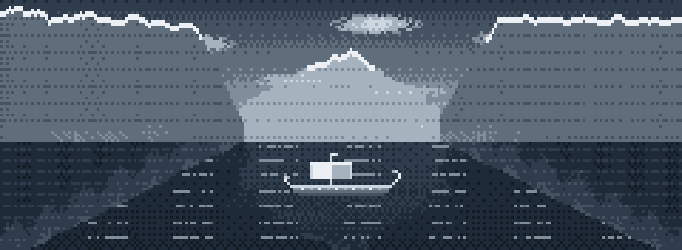
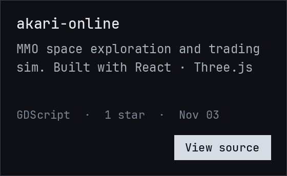
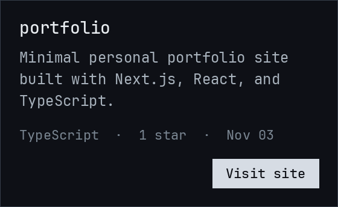
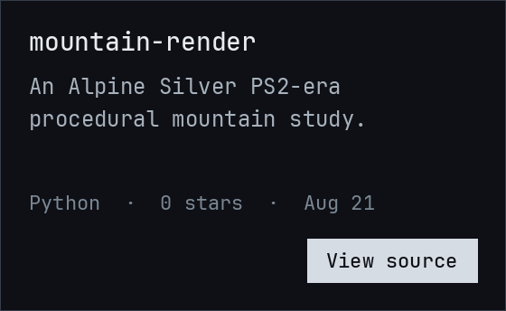

Hunter Bastian · design engineer, Studio Cala

  

[X @hunterbastianux](https://x.com/hunterbastianux) · [email](mailto:hunterbastianux@gmail.com) · [LinkedIn](https://linkedin.com/in/hunterbastian) · [hunterbastian.com](https://hunterbastian.com)
